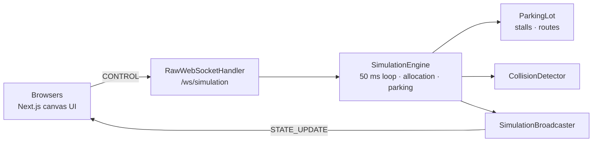

# ParkCore Backend

**Try it: [parkcore-frontend.onrender.com](https://parkcore-frontend.onrender.com)** (the free server
may take a minute to wake up on the first visit).

The simulation engine behind ParkCore: a Spring Boot service that runs a shopping-center
parking lot and streams it live over WebSocket.

- **The lot:** 144 stalls in six rows around three two-lane aisles, an entrance road and a
  store-side road, with the same geometry the frontend draws.
- **The engine:** every 50 ms it spawns arrivals, allocates the free stall closest to the
  store, moves every vehicle along its route while yielding to traffic ahead, parks and
  releases cars, and broadcasts the full state to every client.

The UI that draws the lot is [Parkcore-Frontend](https://github.com/XuanGiaHanNguyen/Parkcore-Frontend).


## Quick start

```bash
docker build -t parkcore-backend . && docker run -p 8080:8080 parkcore-backend
# ws://localhost:8080/ws/simulation
```

Without Docker (JDK ≥ 21):

```bash
./mvnw spring-boot:run          # ws://localhost:8085/ws/simulation
```

The port is `8085` by default and `PORT` overrides it (the Docker image sets `PORT=8080`).
Then start the [frontend](https://github.com/XuanGiaHanNguyen/Parkcore-Frontend).

### Deploy

[`render.yaml`](render.yaml) is a [Render](https://render.com) blueprint: in the dashboard,
**New → Blueprint**, pick this repo, and apply. It creates a Docker web service built from
the `Dockerfile`, deploying from `main`. Render injects `PORT`, which the app reads. The
service only serves the WebSocket, so opening its URL in a browser shows a 404. On the free
plan it sleeps after about 15 idle minutes, and the first visit after that takes about a
minute.

The engine runs a background loop and keeps connections open, so it needs an always-on
host (Render, Railway, Fly.io, a VPS), not serverless functions.

## How the simulation works

Each tick (50 ms of real time, scaled by the speed setting), `SimulationEngine`:

1. **Spawns** a car when the arrival timer fires, the entrance is clear and fewer than 16
   cars are looking for a stall.
2. **Allocates** a stall: one of the four free stalls closest to the store, at random.
   It's reserved immediately so two cars never head for the same one. Handicapped stalls
   go only to permit holders (8% of cars), who prefer them. Police cars get a patrol route
   instead of a stall.
3. **Moves** every vehicle toward its next waypoint, unless `CollisionDetector` says
   something is in its path. Speed ramps up with acceleration, slows to half for
   maneuvers, and the nose turns at a limited rate.
4. **Parks** a car when it reaches its stall, for 30–90 simulated seconds. Then it waits
   for a gap in the aisle (up to 6 s), backs out, U-turns on the store-side road and
   exits. The stall is freed as soon as the car is back in the aisle.
5. **Broadcasts** a snapshot to every connected client.

### Traffic rules

| Rule | What happens |
|---|---|
| Yield to traffic ahead | A vehicle stops if another vehicle is in its path, within half their lengths plus 8 px and within their combined half-widths sideways. Cars beside or behind it don't count, so opposite lanes never block each other. |
| Right of way | If two vehicles are each in the other's path (crossing), the one spawned first goes. |
| Deadlock breaker | After 4 s blocked, a vehicle ignores traffic for 1.2 s. |

### Settings

| Control | Values |
|---|---|
| Speed | slow 0.5×, normal 1×, fast 2× (simulation clock) |
| Density | sparse: an arrival about every 4 s, normal: 2 s, heavy: 0.9 s (±40% jitter) |
| Play / pause / reset | Pause freezes the clock but keeps broadcasting. Reset clears the lot and re-fills about 40% of the stalls. |

### Vehicles

Defined in `VehicleSpawner`. Sizes must match `VEHICLE_SIZE` in the frontend.

| Type | Share | Length × width (px) | Speed (px/s) |
|---|---|---|---|
| `BLUE_CAR`, `RED_CAR`, `GREEN_CAR`, `WHITE_CAR`, `YELLOW_CAR` | 12% each | 40 × 20 | 90 |
| `TAXI` | 10% | 40 × 20 | 95 |
| `VAN` | 12% | 44 × 22 | 75 |
| `SEMI_TRUCK` | 5% | 50 × 24 | 60 |
| `POLICE` (patrols, never parks) | 4% | 40 × 20 | 105 |

## Architecture



One engine instance owns all state. Every client sees, and controls, the same lot. The
loop runs on its own daemon thread. Control messages and the tick share the engine's lock,
and each session is wrapped in a `ConcurrentWebSocketSessionDecorator`, so slow clients
can't stall the loop.

## The model

Coordinates are pixels on a 1000 × 710 canvas, identical to the frontend's `buildLayout`.
If you change the drawing, change `ParkingLot.java` too.

| Region | x range |
|---|---|
| Store | 0–100 |
| Sidewalk | 100–118 |
| Store-side road (U-turns) | 118–218 |
| Lot: 6 rows × 24 stalls (28 × 52), 3 aisles | 218–900 |
| Entrance road: IN lane x = 925 (northbound), OUT lane x = 975 (southbound) | 900–1000 |

Each aisle has a westbound lane (south half) for finding a stall and an eastbound lane
(north half) for leaving. Routes are lists of waypoints (`drive`, `back` for reversing,
`park` for the final point in the stall). `angle` is the direction the nose points
(0 = right, 90 = down).

## WebSocket protocol

Server → client, every tick:

```json
{ "type": "STATE_UPDATE",
  "payload": { "vehicles": [{ "id": "vehicle-12", "type": "TAXI", "x": 512.4, "y": 161.5,
                              "angle": 180, "speed": 90, "state": "MOVING", "spotId": "R1-4" }],
               "vehicleCount": 61, "parkedCount": 44, "totalSpots": 144, "spotsLeft": 89,
               "servedCount": 120, "running": true, "speed": "normal", "density": "normal",
               "avgSpeed": 71.2, "timestamp": 1761789012345 } }
```

Vehicle `state` is `MOVING`, `STOPPED`, `PARKING`, `PARKED` or `EXITING`.

Client → server (every field optional):

```json
{ "type": "CONTROL", "action": "play | pause | reset", "speed": "slow | normal | fast", "density": "sparse | normal | heavy" }
```

## Running the tests

```bash
./mvnw package          # compiles, runs the tests, builds target/backend-0.0.1-SNAPSHOT.jar
java -jar target/backend-0.0.1-SNAPSHOT.jar
```

## Repository layout

```
src/main/java/com/parkcore/backend/
  BackendApplication.java
  config/SimulationConfig.java           starts the engine on boot
  model/ParkingLot.java                  lot geometry (mirrors the frontend) and routes
  model/ParkingSpot.java                 one stall: position, aisle, HC flag, reservation
  model/Vehicle.java                     vehicle state and route
  model/Waypoint.java                    route point: drive / back / park
  simulation/SimulationEngine.java       the loop: spawn, allocate, move, park, exit; controls
  simulation/VehicleSpawner.java         vehicle types, sizes, speeds
  simulation/logic/CollisionDetector.java  path checks and right of way
  broadcast/SimulationBroadcaster.java   wraps state as STATE_UPDATE
  dto/                                   JSON shapes sent to clients
  websocket/                             raw WebSocket endpoint and CONTROL handling
src/main/resources/application.properties  port (PORT, default 8085)
Dockerfile, render.yaml                  container build and Render blueprint
```

Older planning code from the first prototype (`ParkingLotLayout`, `Road`, `RoadNode`,
`PathFinder`, `StopSignHandler`, the behavior stubs) is still in the tree but isn't used
by the engine.
